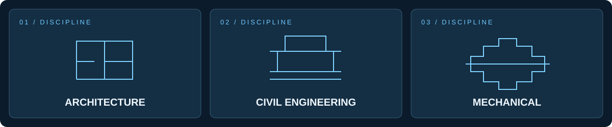

<p align="center"></p>

<p align="center">
  <a href="LICENSE"></a>
  <a href="pyproject.toml"></a>
  <a href="SKILL.md"></a>
  <a href="https://github.com/Haruhi764/OmniCAD-Skill/stargazers"></a>
  <a href="https://github.com/Haruhi764/OmniCAD-Skill/forks"></a>
</p>

<h1 align="center">OmniCAD-Skill — AI CAD 自动绘图与 AutoCAD 自动化</h1>

<p align="center"><strong>让 AI 参与可编辑工程制图，让每一次交付都有据可查。</strong></p>

<p align="center"><a href="README_EN.md">English</a> · <a href="SKILL.md">Agent Skill</a> · <a href="references/v11.md">工作流</a> · <a href="references/validation.md">验收记录</a> · <a href="CHANGELOG.md">更新日志</a></p>

**开源 AI CAD 自动绘图工具（AI CAD Automation / Automatic CAD Drawing）。** OmniCAD 是面向 Codex 和 AI Agent 的 CAD Skill，支持二维工程制图、可编辑 DXF 生成，以及在受支持的 Windows AutoCAD 环境中保存 DWG 和输出 PDF。将经过确认的几何和修改范围转成可编辑 CAD，保留尺寸、来源和验收依据。

**English:** Open-source Codex CAD skill for AI-assisted 2D CAD drawing, AutoCAD automation, DXF generation and engineering drafting with evidence-led verification. [English documentation](README_EN.md).


## 自动绘图演示

<p align="center"></p>

<p align="center"><sub>真实 OmniCAD 生成的 DXF 几何动画回放与 OQA 验收展示，非 AutoCAD 实时录屏。</sub></p>

## 一个 Skill，三类工程制图



| 场景 | 可用能力 |
|---|---|
| 建筑 | 按明确轴网、墙线、门窗和标注生成原生 DXF。用受复核的清单检查坐标、图层、尺寸和布局。 |
| 土木 | 按输入绘制二维构件和剖面元素，核验轴线、标高、几何及注释。 |
| 机械 | 参数化阶梯轴和带凸台法兰。支持轴肩圆角、端部倒角、简化外螺纹、键槽、剖面、配合、圆跳动与粗糙度标注。 |
| 交付 | Windows AutoCAD 原生保存、重开与回读。A3/A1 PDF 出图、严格结构检查及可选重打对照。 |

## 核心优势

- 可编辑 DXF，而非仅生成图纸截图。
- 自动检查、原生 CAD 实测与人工复核分开记录。
- 明确修改范围，保留尺寸与来源证据。
- 按任务选择 light、standard 或 full 验收模式。

## 实际制图案例

真实 AutoCAD 2023 出图，使用仓库中的合成参数，可复现而非概念渲染。

| 阶梯传动轴 | 带凸台法兰 |
| :---: | :---: |
|  |  |
| [复现参数](examples/shaft-c.json) | [复现参数](examples/flange-b.json) |

## 从需求到交付


确认几何与尺寸 → 生成可编辑图纸 → 按需验收 → 在支持的环境中交付 DXF、DWG 或 PDF。

## 安装与快速开始

需要 Python 3.10+。建议使用独立虚拟环境。纯 DXF 使用基础包即可。PDF、图片预检使用 `intake` 附加依赖。原生 DWG/PDF 依赖 Windows、已授权 AutoCAD、可用的出图设置和字体。Poppler 用于 PDF 渲染。

```bash
git clone https://github.com/Haruhi764/OmniCAD-Skill.git
cd OmniCAD-Skill
python -m pip install ".[intake,autocad]"
omnicad mechanical examples/shaft-c.json work-c.json
omnicad build work-c.json work-c.dxf
omnicad oqa work-c.dxf --job work-c.json --domain mechanical --mode standard
omnicad publish work-c.json work-c.dxf native-c --verify-native
```

在 Codex 中使用 Skill 时，将含 [SKILL.md](SKILL.md) 的目录安装到受支持的本地技能目录。CLI 与 Skill 可以分别使用。复用已验证的 [通用支架示例](examples/bracket.json) 时，从 `build` 开始。验收包含人工项目，`publish` 会为缺失的必填视觉证据保留待复核状态。

## 验收与修改范围

- `light` 处理日常结构检查。`standard` 增加专业清单、尺寸证据和文字检查。`full` 补充可用的原生编辑、布局渲染与重打比对。
- `intent` 记录参考图、目标文件、可改区域、应保留信息和缺口。`diff` 检查同一来源的 DXF 前后差异。`revise` 支持自有 DXF 的受限修改、备份和恢复。
- 自动验证、AutoCAD 实测与人工复核分开。项目不会由工程领域名称推断缺失尺寸、套用公差或给出工程合规结论。现有 DWG 的通用编辑仍须使用可信的 CAD 副本。本版未实现 OCR 自动矢量化、BIM、3D 或其他 CAD 厂商适配。

Windows AutoCAD 2023 的验证范围和已知边界见[验证记录](references/validation.md)。后续可扩展其他 CAD 版本和更丰富的专业实体比对，需附真实回归证据。

## CAD 自动绘图常见问题（FAQ）

- 如何使用 AI 自动绘制 CAD 工程图？通过 Codex Skill 或 CLI 将已确认的几何参数转换为可编辑 DXF，再执行验收流程，具体见上方快速开始。
- 如何用 AI 自动化 AutoCAD？在支持的 Windows AutoCAD 环境中使用原生保存、回读和 PDF 出图流程；不需要将图纸仅作为图片交付。
- AI CAD 自动绘图适合哪些工程？当前覆盖建筑、土木和机械的受支持二维制图场景，具体范围见上方能力表。


- 没有 AutoCAD？基础 DXF 生成与检查可以独立运行。
- 支持图片自动矢量化或三维建模？当前不支持。
- 如何反馈？在 [Issues](https://github.com/Haruhi764/OmniCAD-Skill/issues) 提供脱敏复现、软件版本与实际结果。

## 贡献与许可

用合成样例提交最小复现，并运行 `python -m unittest discover -s tests -v`。私有资料留在 Git 忽略的 `.local` 内。[MIT 许可证](LICENSE)适用于本项目原创代码，第三方工具与依赖按各自许可使用。[来源和许可](references/provenance.md)

---

<p align="center"></p>
<p align="center"><strong>OmniCAD · Draft / Verify / Deliver</strong></p>
<p align="center"><a href="CONTRIBUTING.md">参与贡献</a> · <a href="https://github.com/Haruhi764/OmniCAD-Skill/issues">问题反馈</a> · <a href="https://github.com/Haruhi764/OmniCAD-Skill/releases">版本下载</a></p>
