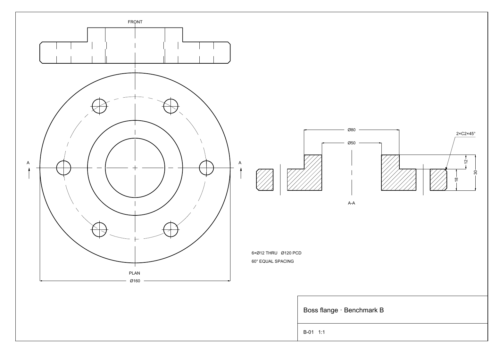

# OmniCAD-Skill

**可编辑 2D CAD 制图与证据验收。** 将经过确认的几何和修改范围转成可编辑 CAD，保留尺寸、来源和验收依据。

[English](README_EN.md) · [V1.1 工作流](references/v11.md) · [验证记录](references/validation.md) · [更新日志](CHANGELOG.md)

| 场景 | 可用能力 |
|---|---|
| 建筑 | 按明确轴网、墙线、门窗和标注生成原生 DXF。用受复核的清单检查坐标、图层、尺寸和布局。 |
| 土木 | 按输入绘制二维构件和剖面元素，核验轴线、标高、几何及注释。 |
| 机械 | 参数化阶梯轴和带凸台法兰。支持轴肩圆角、端部倒角、简化外螺纹、键槽、剖面、配合、圆跳动与粗糙度标注。 |
| 交付 | Windows AutoCAD 原生保存、重开与回读。A3/A1 PDF 出图、严格结构检查及可选重打对照。 |

## 安装与快速开始

需要 Python 3.10+。建议使用独立虚拟环境。纯 DXF 使用基础包即可。PDF、图片预检使用 `intake` 附加依赖。原生 DWG/PDF 依赖 Windows、已授权 AutoCAD、可用的出图设置和字体。Poppler 用于 PDF 渲染。

    python -m pip install ".[intake,autocad]"
    omnicad mechanical examples/shaft-c.json work-c.json
    omnicad build work-c.json work-c.dxf
    omnicad oqa work-c.dxf --job work-c.json --domain mechanical --mode standard
    omnicad publish work-c.json work-c.dxf native-c --verify-native

在 Codex 中使用 Skill 时，将含 [SKILL.md](SKILL.md) 的目录安装到受支持的本地技能目录。CLI 与 Skill 可以分别使用。复用已验证的 [通用支架示例](examples/bracket.json) 时，从 `build` 开始。验收包含人工项目，`publish` 会为缺失的必填视觉证据保留待复核状态。

## 实际制图案例

下图来自仓库合成参数在 AutoCAD 2023 中的实际出图。可用同一参数复现[阶梯传动轴](examples/shaft-c.json)和[带凸台法兰](examples/flange-b.json)。

## 验收与修改范围

- `light` 处理日常结构检查。`standard` 增加专业清单、尺寸证据和文字检查。`full` 补充可用的原生编辑、布局渲染与重打比对。
- `intent` 记录参考图、目标文件、可改区域、应保留信息和缺口。`diff` 检查同一来源的 DXF 前后差异。`revise` 支持自有 DXF 的受限修改、备份和恢复。
- 自动验证、AutoCAD 实测与人工复核分开。项目不会由工程领域名称推断缺失尺寸、套用公差或给出工程合规结论。现有 DWG 的通用编辑仍须使用可信的 CAD 副本。本版未实现 OCR 自动矢量化、BIM、3D 或其他 CAD 厂商适配。

Windows AutoCAD 2023 的验证范围和已知边界见[验证记录](references/validation.md)。后续可扩展其他 CAD 版本和更丰富的专业实体比对，需附真实回归证据。

## 贡献与许可

用合成样例提交最小复现，并运行 `python -m unittest discover -s tests -v`。私有资料留在 Git 忽略的 `.local` 内。[MIT 许可证](LICENSE)适用于本项目原创代码，第三方工具与依赖按各自许可使用。[来源和许可](references/provenance.md)
