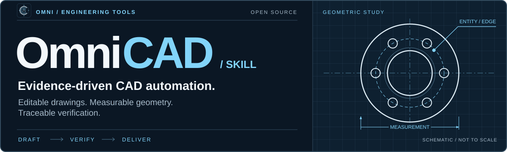
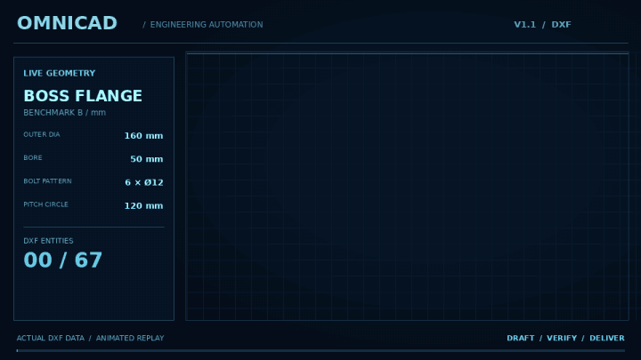
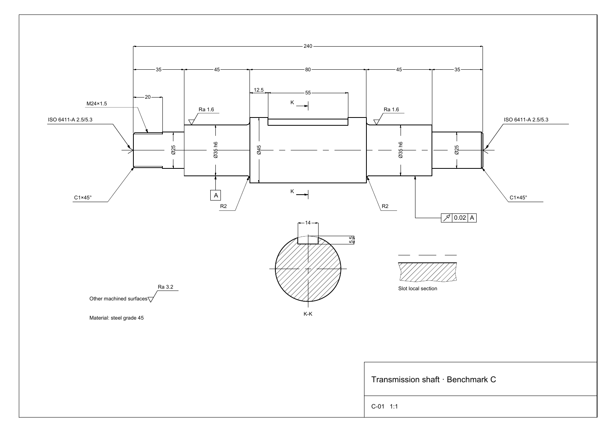
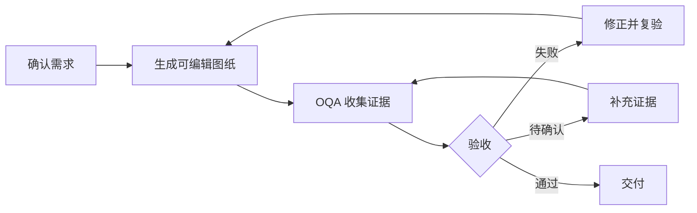

<p align="center"></p>

<p align="center">
  <a href="LICENSE"></a>
  <a href="pyproject.toml"></a>
  <a href="SKILL.md"></a>
  <a href="https://github.com/Haruhi764/OmniCAD-Skill/stargazers"></a>
  <a href="https://github.com/Haruhi764/OmniCAD-Skill/forks"></a>
</p>

<h1 align="center">OmniCAD-Skill — AI CAD 自动绘图与 AutoCAD 自动化</h1>

<p align="center"><strong>不止于绘图，更让每一次交付有据可查。</strong></p>

<p align="center"><a href="README_EN.md">English</a> · <a href="SKILL.md">Agent Skill</a> · <a href="references/v11.md">工作流</a> · <a href="references/validation.md">验收记录</a> · <a href="CHANGELOG.md">更新日志</a></p>

OmniCAD 是我为 Codex 开发的开源 CAD 自动绘图 Skill。它可以根据明确的尺寸和绘图要求生成可编辑 DXF，并在支持的 AutoCAD 环境中输出 DWG 和 PDF。

[快速安装](#安装与快速开始) · [使用说明](SKILL.md) · [更新日志](CHANGELOG.md)

**V1.2.0** 增加原生任务超时与检查点、五类专业图纸验收、逐页打印对照。适用范围和升级方法见[安装与兼容性](references/install-v12.md)。

## 自动绘图演示

<p align="center"></p>

<p align="center"><sub>真实 OmniCAD 生成的 DXF 几何动画回放与 OQA 验收展示，非 AutoCAD 实时录屏。</sub></p>

## 实际制图案例

真实 AutoCAD 2023 出图，使用仓库中的合成参数，可复现而非概念渲染。

| 阶梯传动轴 | 带凸台法兰 |
| :---: | :---: |
|  |  |
| [复现参数](examples/shaft-c.json) | [复现参数](examples/flange-b.json) |

其他实践方向：工业车间布置、工艺流程图、建筑屋面排水图。客户图纸暂不公开。

## 证据驱动 · Evidence-Driven

**看起来画对了，不代表真正通过了验收。**

OmniCAD 将经过确认的工程要求与实际几何、尺寸和出图证据进行比对，而不是依赖 AI 对自己绘图结果的主观判断。



| 证据 | 检查内容 |
| --- | --- |
| Geometry · 几何 | 实体结构、坐标、长度、半径及闭合 |
| Dimension · 尺寸 | 实测值与标注显示值是否一致 |
| Native · 原生 | DWG 重开、可逆编辑与 DXF 回读 |
| Publication · 出图 | PDF 结构、纸张及独立双次打印对照 |
| Review · 复核 | 成果哈希、视觉证据与未解决的工程问题 |

**硬性错误不能靠高分抵消，缺少必要证据则保持待验收状态。** 工程合理性仍需人工专业复核。

### 公开证据中心 · V1.2.0

| 43 项离线测试 | AutoCAD 2023 | 5 类专业验收 |
| :---: | :---: | :---: |
| Windows / Python 3.12 | 原生支架样例实测 | 机械、土木、建筑、食品工艺、车间布置 |

[实际验证记录](references/validation.md) · [验收规则与复现命令](references/acceptance-v12.md)

## 目前支持

- 建筑、土木二维制图：轴网、墙线、门窗、构件及标注。
- 机械制图：阶梯轴、法兰、剖面、键槽、倒角及公差标注。
- DXF 局部修改、差异检查与 OQA 验收。
- Windows AutoCAD 原生 DWG 保存与 PDF 出图。

## 安装与快速开始

需要 Python 3.10+。建议使用独立虚拟环境。纯 DXF 使用基础包即可。PDF、图片预检使用 `intake` 附加依赖。原生 DWG/PDF 依赖 Windows、已授权 AutoCAD、可用的出图设置和字体。Poppler 用于 PDF 渲染。

```bash
git clone --branch v1.2.0 --depth 1 https://github.com/Haruhi764/OmniCAD-Skill.git
cd OmniCAD-Skill
py -3 -m venv .venv-v120
.venv-v120/Scripts/python.exe -m pip install ".[intake,autocad]"
.venv-v120/Scripts/python.exe -m omnicad mechanical examples/shaft-c.json work-c.json
.venv-v120/Scripts/python.exe -m omnicad build work-c.json work-c.dxf
.venv-v120/Scripts/python.exe -m omnicad oqa work-c.dxf --job work-c.json --domain mechanical --mode standard
.venv-v120/Scripts/python.exe -m omnicad publish work-c.json work-c.dxf native-c --verify-native
```

也可从 [Release](https://github.com/Haruhi764/OmniCAD-Skill/releases/tag/v1.2.0) 下载含 wheel 的完整 ZIP。已有 V1.1 用户可按[升级与回滚说明](references/install-v12.md) 并行验证新版本。CLI 与 [Codex Skill](SKILL.md) 可分别安装。验收包含人工项目，`publish` 会为必填视觉证据保留待复核状态。

## 兼容性速览

| 环境 | 状态 |
| --- | --- |
| Python / DXF | 已实现，不要求安装 AutoCAD |
| Windows 完整版 AutoCAD 2023 | 原生出图已实测 |
| AutoCAD 2021 / 其他版本 | 原生验收待验证 |
| AutoCAD LT | 实验性 DXF 交换，LT 2027 实机验收待完成 |
| macOS | 不支持 Windows COM 原生路径，纯 DXF 流程尚未独立验证 |

## 开发计划

- [x] AutoCAD 二维绘图与验收
- [ ] AutoCAD LT 兼容（Experimental，可选 DXF 交换。LT 2027 实机验收待完成）
- [ ] SolidWorks 建模与装配
- [ ] Revit BIM 建模

后续功能尚未集成，具体支持范围见 [验证记录](references/validation.md)。

## 开源成长记录

[](https://star-history.com/#Haruhi764/OmniCAD-Skill&Date)

## 反馈与贡献

欢迎提交 [Issue](https://github.com/Haruhi764/OmniCAD-Skill/issues)，附软件版本及脱敏复现。现有绘图工作流见 [V1.1 文档](references/v11.md)，类型验收见 [V1.2 验收说明](references/acceptance-v12.md)，LT 用户可选用 [Experimental 测试包](references/lt-compatibility.md)。贡献方式见 [CONTRIBUTING.md](CONTRIBUTING.md)。二维工程图仍需人工专业复核。

项目采用 [MIT 许可证](LICENSE)，第三方许可见 [来源说明](references/provenance.md)。如果这个项目对你有帮助，欢迎 Star。

---

<p align="center"></p>
<p align="center"><strong>OmniCAD · Draft / Verify / Deliver</strong></p>
<p align="center"><a href="CONTRIBUTING.md">参与贡献</a> · <a href="https://github.com/Haruhi764/OmniCAD-Skill/issues">问题反馈</a> · <a href="https://github.com/Haruhi764/OmniCAD-Skill/releases">版本下载</a></p>
