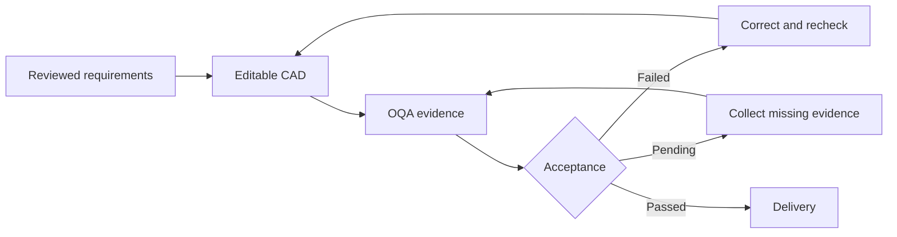

<p align="center"></p>

<p align="center">
  <a href="LICENSE"></a>
  <a href="pyproject.toml"></a>
  <a href="SKILL.md"></a>
  <a href="https://github.com/Haruhi764/OmniCAD-Skill/stargazers"></a>
  <a href="https://github.com/Haruhi764/OmniCAD-Skill/forks"></a>
</p>

<h1 align="center">OmniCAD-Skill — AI CAD Automation &amp; Automatic CAD Drawing</h1>

<p align="center"><strong>Don't just draw. Verify with evidence.</strong></p>

<p align="center"><a href="README.md">中文</a> · <a href="SKILL.md">Agent Skill</a> · <a href="references/v11.md">Workflow</a> · <a href="references/validation.md">Validation</a> · <a href="CHANGELOG.md">Changelog</a></p>

OmniCAD is an open-source CAD automation skill for Codex. Generate editable DXF from reviewed dimensions and drafting requirements, and publish DWG and PDF in supported AutoCAD environments.

[Quick start](#quick-start) · [Skill instructions](SKILL.md) · [Changelog](CHANGELOG.md)

**V1.2.0** adds bounded native jobs, hash-verified checkpoints, acceptance profiles for five drawing disciplines, and page-by-page print comparison. See [installation and compatibility](references/install-v12.md).

## Drawing showcase

<p align="center"></p>

<p align="center"><sub>Actual OmniCAD-generated DXF geometry, animated replay with OQA evidence; not a live AutoCAD recording.</sub></p>

## Real drawing examples

Native AutoCAD 2023 plots from reproducible synthetic repository inputs, not concept renders.

| Transmission shaft | Boss flange |
| :---: | :---: |
|  |  |
| [Reproduce](examples/shaft-c.json) | [Reproduce](examples/flange-b.json) |

Other drafting experience includes industrial layouts, process diagrams and roof drainage plans. Client drawings are not public.

## Evidence-driven engineering

**A drawing that looks right is not necessarily a drawing that passes.**

OmniCAD checks actual geometry and measurements against reviewed requirements, rather than relying on the agent's own confidence.



| Evidence | What is checked |
| --- | --- |
| Geometry | Entity structure, coordinates, lengths, radii and closure |
| Dimensions | Actual measurements versus displayed values |
| Native CAD | DWG reopening, reversible editing and DXF readback |
| Publication | PDF structure, paper size and independent replot comparison |
| Review | Artifact hashes, visual evidence and unresolved engineering questions |

**Hard failures cannot be offset by a high quality score. Missing required evidence remains pending.** Human engineering review is still necessary.

### Evidence center · V1.2.0

| 43 offline tests | AutoCAD 2023 | 5 acceptance profiles |
| :---: | :---: | :---: |
| Windows / Python 3.12 | Native bracket smoke test | Mechanical, civil, architecture, food process, workshop layout |

[Recorded test results](references/validation.md) · [Acceptance rules and reproducible commands](references/acceptance-v12.md)

## Features

- Architectural and civil 2D drafting: grids, walls, openings, components and annotations.
- Mechanical drafting: stepped shafts, flanges, sections, keyways, chamfers and tolerances.
- Scoped DXF revisions, comparisons and OQA checks.
- Native DWG and PDF publication with supported Windows AutoCAD.

## Quick start

Requires Python 3.10+. Native DWG/PDF publication uses licensed Windows AutoCAD and its PDF plot configuration. PNG previews use Poppler.

```bash
git clone --branch v1.2.0 --depth 1 https://github.com/Haruhi764/OmniCAD-Skill.git
cd OmniCAD-Skill
py -3 -m venv .venv-v120
.venv-v120/Scripts/python.exe -m pip install ".[intake,autocad]"
.venv-v120/Scripts/python.exe -m omnicad mechanical examples/shaft-c.json job.json
.venv-v120/Scripts/python.exe -m omnicad build job.json drawing.dxf
.venv-v120/Scripts/python.exe -m omnicad oqa drawing.dxf --job job.json --domain mechanical --mode standard
.venv-v120/Scripts/python.exe -m omnicad publish job.json drawing.dxf publication --verify-native
```

The [release ZIP](https://github.com/Haruhi764/OmniCAD-Skill/releases/tag/v1.2.0) includes an installable wheel. Follow the [side-by-side upgrade and rollback guide](references/install-v12.md) if you use V1.1. Install the folder containing [SKILL.md](SKILL.md) in a supported local skill directory to use it from Codex.

## Compatibility at a glance

| Environment | Status |
| --- | --- |
| Python DXF workflow | Implemented; no AutoCAD required |
| Full AutoCAD 2023 on Windows | Native publication tested |
| AutoCAD 2021 / other versions | Native verification pending |
| AutoCAD LT | Experimental DXF exchange; native LT 2027 verification pending |
| macOS | Native Windows COM route unavailable; local DXF workflow not independently verified |

## Roadmap

- [x] AutoCAD 2D drafting and verification
- [ ] AutoCAD LT compatibility (Experimental opt-in DXF exchange, LT 2027 native verification pending)
- [ ] SolidWorks modeling and assemblies
- [ ] Revit BIM modeling

Planned integrations are not part of the current release. See [validation](references/validation.md) for tested scope.

## Project growth

[](https://star-history.com/#Haruhi764/OmniCAD-Skill&Date)

## Feedback and contributions

Open an [issue](https://github.com/Haruhi764/OmniCAD-Skill/issues) with your software version and a sanitized reproduction. See the [existing workflow](references/v11.md), [V1.2 acceptance guide](references/acceptance-v12.md) and [contribution guide](CONTRIBUTING.md). AutoCAD LT users are invited to try the [Experimental kit](references/lt-compatibility.md). Engineering judgment requires human review.

[MIT license](LICENSE) · [Third-party provenance](references/provenance.md). Star the project if you find it useful.

---

<p align="center"></p>
<p align="center"><strong>OmniCAD · Draft / Verify / Deliver</strong></p>
<p align="center"><a href="CONTRIBUTING.md">Contribute</a> · <a href="https://github.com/Haruhi764/OmniCAD-Skill/issues">Report an issue</a> · <a href="https://github.com/Haruhi764/OmniCAD-Skill/releases">Releases</a></p>
