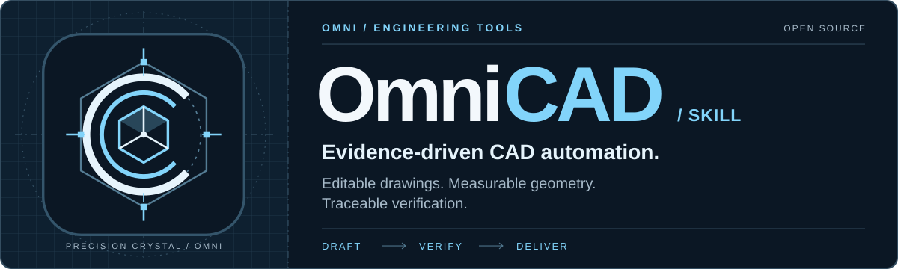
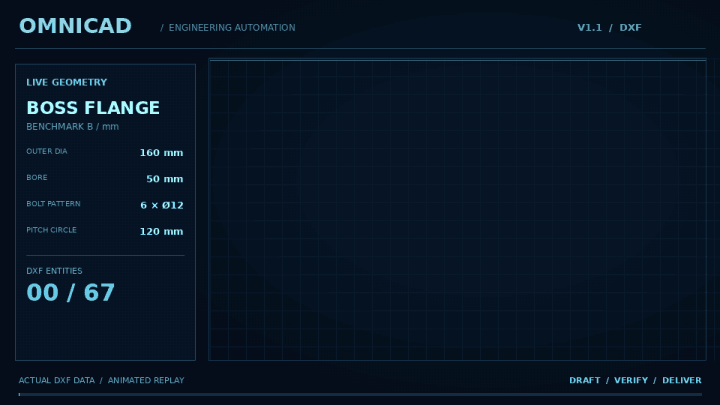
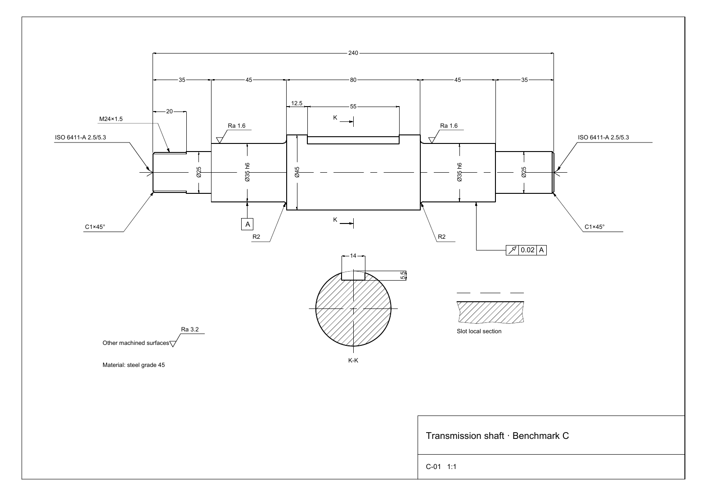
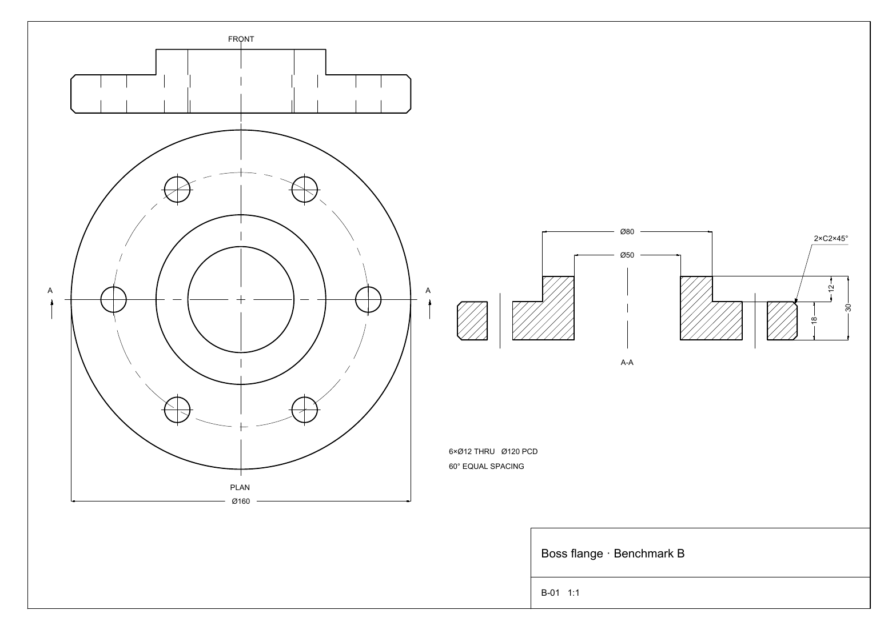
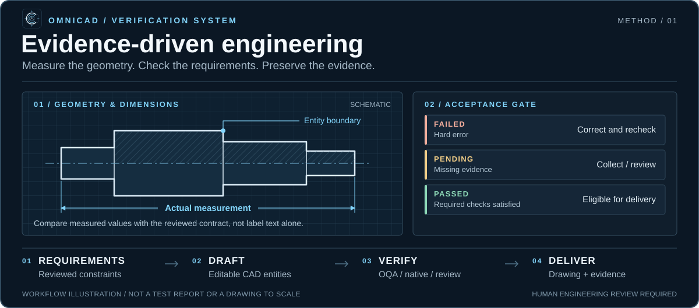

<p align="center"></p>

<p align="center">
  <a href="LICENSE"></a>
  <a href="pyproject.toml"></a>
  <a href="SKILL.md"></a>
  <a href="https://github.com/Haruhi764/OmniCAD-Skill/stargazers"></a>
  <a href="https://github.com/Haruhi764/OmniCAD-Skill/forks"></a>
</p>

<h1 align="center">OmniCAD-Skill — AI CAD Automation &amp; Automatic CAD Drawing</h1>

<p align="center"><strong>Don't just draw. Verify with evidence.</strong></p>

<p align="center"><a href="README.md">中文</a> · <a href="SKILL.md">Agent Skill</a> · <a href="references/v11.md">Workflow</a> · <a href="references/validation.md">Validation</a> · <a href="CHANGELOG.md">Changelog</a></p>

OmniCAD is an open-source CAD automation skill for Codex, combining editable 2D DXF drafting, scoped drawing revisions and evidence-driven engineering QA (OQA). It can publish native DWG and PDF through supported full AutoCAD on Windows. Its Python DXF workflow does not require AutoCAD.

[Quick start](#quick-start) · [Drawing portfolio](#drawing-portfolio) · [Evidence-driven engineering](#evidence-driven-engineering) · [Evidence index](references/evidence-index.md)

**V1.2.0** adds bounded native jobs, hash-verified checkpoints, acceptance profiles for five drawing disciplines, and page-by-page print comparison. See [installation and compatibility](references/install-v12.md).

## Drawing showcase

<p align="center"></p>

<p align="center"><sub>Actual OmniCAD-generated DXF geometry, animated replay with OQA evidence; not a live AutoCAD recording.</sub></p>

## Drawing portfolio

Native AutoCAD 2023 plots reproduced from synthetic repository inputs. Click either drawing to inspect the original preview.

| 01 / Transmission shaft | 02 / Boss flange |
| :---: | :---: |
| [](examples/previews/shaft-c.png) | [](examples/previews/flange-b.png) |
| 240 mm overall · 5 lands · keyway and sections | Ø160 mm · Ø50 bore · 6 × Ø12 on PCD 120 |
| [Source parameters](examples/shaft-c.json) · [Validation](references/validation.md) | [Source parameters](examples/flange-b.json) · [Validation](references/validation.md) |

Other practical work includes industrial layouts, process diagrams and roof drainage plans. Private client drawings are not published.

## Evidence-driven engineering

<p align="center"></p>

A drawing can look right while its dimensions are wrong. OmniCAD verifies measured geometry against reviewed requirements, rather than trusting the drawing's appearance or the agent's own assessment.

| Evidence layer | Verification |
| :--- | :--- |
| **01 / Geometry & dimensions** | Entity structure, coordinates, lengths, radii, closure and measured dimensions versus displayed values. |
| **02 / Native CAD & publication** | DWG reopening, reversible editing, DXF readback, PDF structure, paper size and independent replot comparison. |
| **03 / Traceability & review** | Artifact hashes, visual evidence and unresolved engineering requirements. |

**A hard failure cannot be offset by a high score. Missing required evidence remains pending.** Automated checks do not replace professional engineering review.

### Designed to detect failure, not just produce output

| What can go wrong | How OmniCAD checks it |
| --- | --- |
| A dimension label is correct but its geometry is not | Compare measured native geometry with the reviewed contract. |
| A requested edit changes unrelated entities | Compare same-lineage drawings against the allowed revision scope. |
| A previously approved drawing is modified | Bind review evidence to artifact hashes; stale evidence cannot authorize delivery. |
| AutoCAD stalls or returns an invalid artifact | Bound native execution, preserve checkpoints and require host review before circuit reset. |

These are implemented regression scenarios, not new performance claims. See the [public evidence index](references/evidence-index.md) for source parameters, relevant test files and verification boundaries.

#### V1.2.0 · Recorded evidence

| **43** offline tests | **AutoCAD 2023** | **5** acceptance profiles |
| :---: | :---: | :---: |
| Release record · Windows / Python 3.12 | Native bracket smoke test | Mechanical · Civil · Architecture · Food process · Workshop layout |

[Validation records](references/validation.md) · [Acceptance rules](references/acceptance-v12.md) · [Live CI status](https://github.com/Haruhi764/OmniCAD-Skill/actions)

## Features

- Architectural and civil 2D drafting: grids, walls, openings, components and annotations.
- Mechanical drafting: stepped shafts, flanges, sections, keyways, chamfers and tolerances.
- Scoped DXF revisions, comparisons and OQA checks.
- Native DWG and PDF publication with supported Windows AutoCAD.

## Quick start

**Using Codex? Start here.**

1. Download the [V1.2.0 release ZIP](https://github.com/Haruhi764/OmniCAD-Skill/releases/tag/v1.2.0) and verify its checksum using the [installation guide](references/install-v12.md).
2. Install the CLI in a separate Python 3.10+ environment as described in that guide.
3. Enable the source folder containing [SKILL.md](SKILL.md) in a supported Codex skill directory. Keep only one active version.

[Download release](https://github.com/Haruhi764/OmniCAD-Skill/releases/tag/v1.2.0) · [Install / upgrade / rollback](references/install-v12.md) · [LT experimental guide](references/lt-compatibility.md)

<details>
<summary><strong>Developer walkthrough — build, check and publish a reproducible drawing</strong></summary>

Windows example, using Python 3.10+ and a separate virtual environment:

```bash
git clone --branch v1.2.0 --depth 1 https://github.com/Haruhi764/OmniCAD-Skill.git
cd OmniCAD-Skill
py -3 -m venv .venv-v120
.venv-v120/Scripts/python.exe -m pip install ".[intake,autocad]"
.venv-v120/Scripts/python.exe -m omnicad mechanical examples/shaft-c.json job.json
.venv-v120/Scripts/python.exe -m omnicad build job.json drawing.dxf
.venv-v120/Scripts/python.exe -m omnicad oqa drawing.dxf --job job.json --domain mechanical --mode standard
.venv-v120/Scripts/python.exe -m omnicad publish job.json drawing.dxf publication --verify-native
```

</details>

The base package supports DXF without AutoCAD. PDF and image intake use the `intake` extra; native DWG/PDF requires licensed full Windows AutoCAD and suitable plot settings. Poppler is required for render comparison. Native delivery still requires visual and engineering review.

## Compatibility at a glance

| Environment | Status |
| --- | --- |
| Python DXF workflow | Implemented; no AutoCAD required |
| Full AutoCAD 2023 on Windows | Native publication tested |
| AutoCAD 2021 / other versions | Native verification pending |
| AutoCAD LT | Experimental DXF exchange; native LT 2027 verification pending |
| macOS | Native Windows COM route unavailable; local DXF workflow not independently verified |

## Frequently asked questions

<details>
<summary><strong>Can I use OmniCAD without AutoCAD?</strong></summary>

Yes, for the Python-based editable DXF workflow. Native DWG/PDF publication is a separate workflow requiring a supported Windows AutoCAD installation.

</details>

<details>
<summary><strong>Can it revise existing drawings?</strong></summary>

Scoped revisions of supported DXF entities and same-lineage drawing comparisons are implemented. Arbitrary legacy DWG editing and preservation of all proprietary objects are not guaranteed.

</details>

<details>
<summary><strong>Does it support simulation, 3D assembly, BIM or CNC?</strong></summary>

These are not established capabilities of the current release. OmniCAD focuses on editable 2D drawings and their verification.

</details>

## Roadmap

- [x] AutoCAD 2D drafting and verification
- [ ] AutoCAD LT compatibility (Experimental opt-in DXF exchange, LT 2027 native verification pending)
- [ ] SolidWorks modeling and assemblies
- [ ] Revit BIM modeling

Planned integrations are not part of the current release. See [validation](references/validation.md) for tested scope.

## Feedback and contributions

Open an [issue](https://github.com/Haruhi764/OmniCAD-Skill/issues) with your software version and a sanitized reproduction. See the [existing workflow](references/v11.md), [V1.2 acceptance guide](references/acceptance-v12.md) and [contribution guide](CONTRIBUTING.md). AutoCAD LT users are invited to try the [Experimental kit](references/lt-compatibility.md). Engineering judgment requires human review.

[MIT license](LICENSE) · [Third-party provenance](references/provenance.md). Star the project if you find it useful.


## Community & Support

**OmniCAD official QQ technical community — `313181842`**

Join the group for installation questions, bug reports, compatibility testing and feature suggestions. For reproducible issues, please also use [GitHub Issues](https://github.com/Haruhi764/OmniCAD-Skill/issues), including your CAD version, operating system and sanitized examples. Do not share confidential drawings or license information.

---

<p align="center"></p>
<p align="center"><strong>OmniCAD · Draft / Verify / Deliver</strong></p>
<p align="center"><a href="CONTRIBUTING.md">Contribute</a> · <a href="https://github.com/Haruhi764/OmniCAD-Skill/issues">Report an issue</a> · <a href="https://github.com/Haruhi764/OmniCAD-Skill/releases">Releases</a></p>
